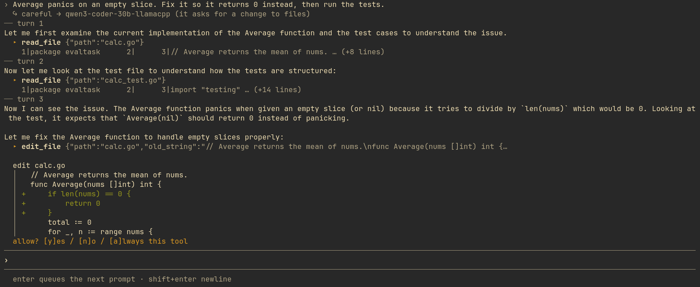

<p align="center">
  
</p>

<h1 align="center">froe</h1>

<p align="center">
  <em>An open-source coding agent that runs on your own machine.<br>
  Terminal and Neovim, open models, and no source code leaving the machine.</em>
</p>

<p align="center">
  <a href="#install">Install</a> ·
  <a href="#using-it">Using it</a> ·
  <a href="#plain-code-checks-the-model">Checking the model</a> ·
  <a href="#evaluation">Evaluation</a> ·
  <a href="docs/ARCHITECTURE.md">Architecture</a>
</p>

---

Froe reads, edits and runs code in your project, the way a hosted coding agent
does, but the model runs on your own hardware: an open model on an open runtime
([llama.cpp](https://github.com/ggml-org/llama.cpp) by default). Plain Go code
checks the model's work wherever it can, and every edit, command and web search
waits for your approval.

<p align="center">
  
</p>

- **Your code stays on your machine.** Froe is MIT, every runtime it ships with
  is open source, and nothing local falls back to a hosted model unless you say so.
- **Plain code checks the model.** After the model answers, deterministic Go
  verifies what it can, and the model never writes a git command.
- **Measured on an ordinary laptop.** 24 of 30 eval runs pass in about 15
  minutes on an 8 GB GPU with 16 GB of RAM. [The numbers](#evaluation).
- **No model is compiled in.** The best local model changes every few months, so
  models are registry entries, hardware is detected, and `froe doctor` reports
  what a machine can actually run.
- **One binary, two clients.** The terminal and Neovim share one agent, one
  permission gate and one session store.

A froe is a riving tool: you set the blade on the end grain and strike it, and
the wood splits along its own grain. The tool supplies the edge; you decide
where the stroke lands.

## Install

You need Linux, Go, a GPU with 8 GB or more, and about 20 GB of disk for the
default model.

```bash
gh repo clone dcoldeira/froe && cd froe
make install              # froe and froe-llamacpp → ~/.local/bin
froe doctor               # what this machine can run
```

Then build llama.cpp and download the default model, Qwen3-Coder-30B-A3B
(Q4_K_M, 18.6 GB) to `~/models/`. [`docs/SETUP.md`](docs/SETUP.md) has both steps,
and the Neovim plugin. You don't start the model yourself: when llama-server is
down, froe starts it before the first request.

Qwen3-Coder-30B-A3B is a mixture-of-experts model with 3.3B of its 30.5B
parameters active per token, so it runs on an 8 GB card with the rest of the
experts on the CPU. `froe-llamacpp` runs it with one slot (each turn reads only
what is new), the model's own chat template for native tool calls, and a 32K
window.

Froe speaks OpenAI-compatible `/v1/chat/completions`, so Ollama, vLLM and
[colibri](https://github.com/JustVugg/colibri) work through the same adapter.
Mistral and Anthropic adapters exist for when local hardware can't fit the job.

⚠ Ollama's `num_ctx` defaults to 4096 and **silently truncates** everything past it.

## Using it

Run `froe` in any project directory to start a session. It keeps its memory of
the project between sessions, and it can search the web.

```bash
cd ~/my-project
froe                          # interactive session (also: froe chat)
```

From Neovim, over JSON-RPC to the same binary:

```vim
:Froe fix the null guard in this function
```

Commands, keymaps and a short how-to: [`nvim/README.md`](nvim/README.md).

Some jobs are small enough that an open-ended session only wastes time. Each of
these does one job with a fresh context and the smallest turn budget that fits,
then hands control back:

```bash
froe locate "<issue text>"    # WHERE in the code does this live? (read-only)
froe commit -a -m "…" -p      # staged diff → message → commit → push
froe ask "<question>"         # one question, one answer, no tools
froe do "<task>"              # one task, the full agent loop, then exit
froe map                      # the project map the model is given
froe memory                   # durable facts about this project
froe sessions                 # list or replay past conversations
```

## Plain code checks the model

The biggest gain did not come from a larger window or a better prompt. It came
from **deterministic Go that checks the model's answer once it has finished**.

`froe locate` re-runs the model's own successful searches inside the files it
cited, and reports the lines it missed. That costs no turns and no tokens, and
most of `locate`'s reliability came from it rather than from anything the model
was told. Measured on a fixture built at the real thing's difficulty — 405 Python
files, an 1876-line target, four decoys that all match the obvious glob:

| | pass rate (3 repeats) | median turns |
|---|---|---|
| baseline | 0/3 | 6 |
| + relaxed separators in the verification sweep | 1/3 | 6 |
| + searches derived from the report's own quoted phrases | 2/3 | 6 |
| + **searching the project before turn 1** | **3/3** | **4** |

For `froe commit`, the model is only ever asked for *message text*, never for
commands. Every git call is fixed Go with a fixed argv and no shell.

## Design in one paragraph

A single static Go binary (~13k lines) holds the agent loop, the tool
implementations and the provider adapters. Tool calls are produced three
different ways — GBNF grammar, native tool-calling, or a ReAct text protocol —
because which one works is a property of the *model*, not a global default. A
~580-line Lua plugin drives the same binary from Neovim over JSON-RPC on stdio,
the LSP pattern, so the editor and the terminal share one implementation.

- [`docs/ARCHITECTURE.md`](docs/ARCHITECTURE.md) — how the pieces fit
- [`docs/MODELS.md`](docs/MODELS.md) — the registry, hardware profiles, runtimes
- [`docs/SETUP.md`](docs/SETUP.md) — bare machine to working install
- [`docs/ROADMAP.md`](docs/ROADMAP.md) — open work, each item from an observed problem
- [`docs/DECISIONS.md`](docs/DECISIONS.md) — the design decisions and where each is enforced
- [`TESTING.md`](TESTING.md) — unit tests, the switched-off rule, eval hygiene

## Evaluation

`eval/` holds ten tasks, each scored as a **pass rate over repeats** against a
120 s bar per run. Variance between identical runs of an agent is large enough
to swamp the effect of a real fix, so one run cannot tell you whether a change
helped.

```bash
bash eval/run.sh            # all tasks
ONLY=01-fix-panic bash eval/run.sh
```

On a laptop with an 8 GB RTX 4060 and 16 GB of RAM, 3 runs per task:

| Model | Runtime | Score | Suite time |
|---|---|---|---|
| **Qwen3-Coder 30B-A3B** (default, 32K window) | **llama.cpp** | **24/30** | **15m13s** |
| Qwen3-Coder 30B-A3B, same file | colibri | 16/30 | 62m55s |
| Ministral 3 8B | Ollama | 19/30 | 6m24s |

Every task passes 3/3 except the two that locate code from a bug report, where
the model answers too early. The model generates ~22-35 tokens a second on
llama.cpp, against ~5 on colibri, where most experts sit on the CPU. Every run,
the tasks and the failure modes: [`eval/README.md`](eval/README.md).

## Status, honestly

Public since 2026-09-23. Linux is where it is used and measured. It builds for
macOS and Windows, but neither has been run end to end; on Windows, use WSL2
for now.

In daily use: `froe commit` drives the releases of
[QRL](https://github.com/entangledcode/qrl) and [Bell](https://bell.entangledcode.dev),
the two projects it was built to develop, and froe is developed with froe.

llama.cpp has been the default runtime since 2026-11-06, measured against
colibri on the same model file. colibri stays supported, and two fixes found
while building froe around it are merged upstream
([#2535](https://github.com/JustVugg/colibri/pull/2535),
[#2537](https://github.com/JustVugg/colibri/pull/2537)). Open work is in
[`docs/ROADMAP.md`](docs/ROADMAP.md).

**Not claimed:** this is not a replacement for a frontier-model coding agent, and
it is not trying to be. It is what local open models can honestly do on the
machine in front of you, plus a lot of deterministic Go making sure the model did
not quietly get it wrong.

## Licence

MIT — see [`LICENSE`](LICENSE). Contributions are covered by [`CLA.md`](CLA.md);
sign it before a pull request can be merged.
